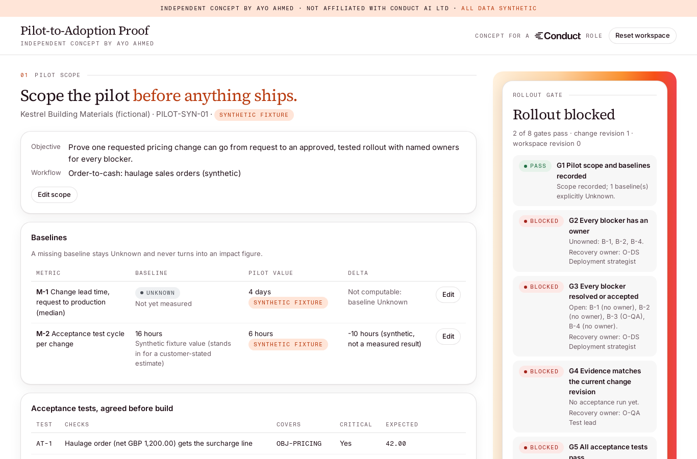

# Pilot-to-Adoption Proof

An independent concept by **Ayo Ahmed** for the Deployment Strategist (UK) role at Conduct.
Not an official Conduct product, not affiliated with or endorsed by Conduct AI Ltd, and it does not
reproduce Conduct's internals. **All data is synthetic**: the account, people, systems, tests and
cohort are invented. No SAP system is accessed and no ABAP is analysed.

## Live release
- Live demo: https://conduct-pilot-adoption.ayoahmed-49d.workers.dev
- Voiced public walkthrough: https://drive.google.com/file/d/1Tsq6ynU3aWqDtuHboy0I4dzwtUSw00AI/view?usp=drivesdk&authuser=ayomideahmedcp%40gmail.com
- Release record: [docs/LIVE_RELEASE.md](docs/LIVE_RELEASE.md)

One screen takes a single synthetic change request from pilot scope to adoption:

1. **Pilot scope**: objective, workflow, baselines (Unknown stays Unknown, no delta) and acceptance tests.
2. **Change impact**: the request walked through a synthetic dependency graph with depth, relation and owner.
3. **Blockers**: each needs an owner; resolving one that fixes the environment bumps the change revision.
4. **Acceptance evidence**: expected vs actual per test, with run time, revision and fingerprint.
   Failed or stale (over 24 h) evidence blocks approval and rollout and names a recovery owner.
5. **Approval and rollout**: approval binds to the exact revision, fingerprint and run. Rollout is
   simulated and writes nothing external.
6. **Cohort**: activation and adoption with numerator, denominator, exclusions, unknowns, a hold
   under 20 users and a by-role split that flags when the aggregate hides a gap.
7. **Exports**: customer success handoff, reusable deployment playbook, and a product-feedback
   packet where verified findings must cite evidence and hypotheses are kept separate.



## Run it
```bash
npm ci
npm run dev          # http://localhost:8787
npm test             # 65 tests
npm run eval         # 12 expected/actual evaluations
npm run eval:broken  # deliberately weakened freshness rule: 1 red, exit 1
npm run ui:check     # with dev running: 24 browser checks incl. axe, keyboard, dialogs
npm run check:wrangler
cd demo && node record.mjs   # with dev running: deterministic walkthrough frames
```

## How it works
- `src/worker.ts`: Cloudflare Worker. Gives each visitor a random HttpOnly cookie and routes them
  to their own SQLite-backed Durable Object (`PilotWorkspace`). Same-origin JSON only, 128 KB body cap counted in UTF-8 bytes while streaming.
- `src/store.ts`: transactional state, optimistic revision checks, idempotency keys, bounded rows,
  14-day idle wipe.
- `src/engine/`: pure rules (gates, impact walk, acceptance suite, cohort metrics, exports), shared
  by the Worker, tests and evals.
- `public/`: vanilla HTML/CSS/JS, rendered with `textContent` only.

## Pre-release status (historical)
Superseded by the current [live release record](docs/LIVE_RELEASE.md). Before release, this read:
Cloudflare Workers Free configuration is prepared in `wrangler.jsonc` and the dry run passes.
**Not deployed.** See `docs/deploy.md`.

## Docs
[PRD](docs/prd.md) · [ELI5](docs/eli5.md) · [Five Whys](docs/five-whys.md) · [JTBD](docs/jtbd.md) ·
[Discovery and interview guide](docs/discovery.md) · [Metrics](docs/metrics.md) ·
[Assumptions](docs/assumptions.md) · [Trade-offs](docs/tradeoffs.md) · [Risks](docs/risks.md) ·
[Build vs buy](docs/build-vs-buy.md) · [Role viability](docs/role-viability.md) ·
[v2 roadmap](docs/roadmap-v2.md) · [Decision log](docs/decision-log.md) ·
[Test results](docs/test-results.md) · [Claims and caveats](docs/claims-and-caveats.md) ·
[Research](docs/research.md) · [Design](design.md) · [Deploy](docs/deploy.md) ·
[Walkthrough script](docs/video/script.md) · [Live release record](docs/LIVE_RELEASE.md)

No interviews have been run and nothing here measures real adoption or business impact.

© Ayo Ahmed. Conduct and its marks belong to their owner and appear only to identify the role.
